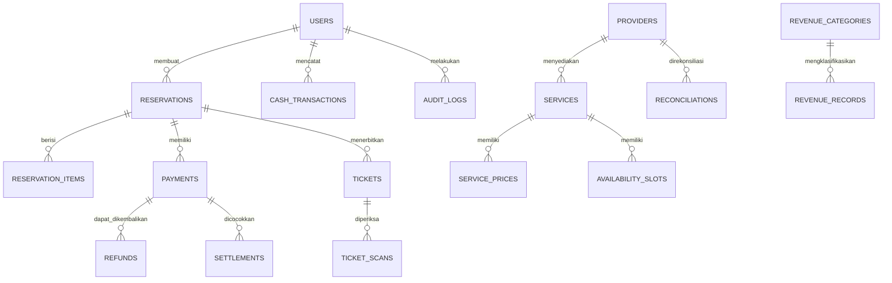

# PRD — Pesawaran TourismPay

**Product Requirements Document · Versi 1.0 · 20 Oktober 2026**

| | |
| --- | --- |
| **Status dokumen** | Draft untuk validasi |
| **Judul** | Sistem Reservasi, Pembayaran, dan Transparansi Transaksi Wisata |
| **Pemilik produk** | Pemda/BUMD Kabupaten Pesawaran |
| **Lokasi pilot** | Pulau Pahawang, Lampung |
| **Platform** | Website responsif untuk ponsel dan desktop |
| **Target** | MVP berfungsi dan siap diuji coba dalam 3 bulan |
| **Model pembayaran** | QRIS melalui mitra pembayaran berizin, dengan pencatatan transaksi tunai sebagai alternatif |

---

## Ringkasan produk

Pesawaran TourismPay adalah platform digital yang mengintegrasikan reservasi wisata, tiket digital, pencatatan pembayaran, rekonsiliasi transaksi, dan laporan pendapatan wisata di Pulau Pahawang.

Produk ini ditujukan untuk wisatawan, pengelola destinasi, operator kapal, homestay, UMKM, serta Pemda/BUMD.

**Prinsip utama produk:**

- Satu website untuk pemesanan layanan wisata yang masuk dalam cakupan pilot.
- Pembayaran digital melalui mitra berizin, tanpa TourismPay menampung dana pengguna.
- Transaksi tunai tetap dapat dicatat agar aktivitas operasional tidak bergantung sepenuhnya pada QRIS.
- Operasional dasar tetap terbantu ketika sinyal lemah, tetapi pembayaran digital tidak diasumsikan bisa diselesaikan secara offline.
- Laporan membedakan transaksi usaha, pembayaran yang berhasil, dan penerimaan daerah yang benar-benar menjadi hak Pemda.

> **Batas cakupan:** MVP bukan aplikasi penerbit uang elektronik, bukan pengganti QRIS, dan bukan sistem akuntansi pemerintah secara keseluruhan.

---

## 1. Problem statement — siapa yang dirugikan dan kenapa

### Masalah utama

Aktivitas wisata melibatkan beberapa penyedia layanan dengan proses pemesanan dan pembayaran yang berpotensi terpisah. Kondisi ini dapat menyebabkan informasi reservasi tidak konsisten, pencatatan transaksi manual, dan kesulitan menyamakan transaksi dengan setoran.

| Pihak terdampak | Masalah | Dampak |
| --- | --- | --- |
| Wisatawan | Harus menghubungi penyedia berbeda dan mengonfirmasi pembayaran secara manual | Proses pemesanan lebih lama dan informasi harga kurang jelas |
| Pengelola destinasi | Pencatatan tiket dan pengunjung belum tentu terintegrasi | Rekap harian membutuhkan pekerjaan manual |
| Operator kapal | Jadwal, kapasitas, dan daftar penumpang berpotensi tercatat terpisah | Risiko pemesanan ganda dan ketidaksesuaian manifest |
| Homestay | Reservasi dan status pembayaran perlu diperbarui secara terpisah | Risiko konflik ketersediaan |
| UMKM | Transaksi tunai dan digital perlu direkap, sementara kemampuan digital beragam | Beban administrasi dan kesulitan membuat laporan |
| Pemda/BUMD | Data kunjungan, transaksi, dan penerimaan daerah berasal dari sumber berbeda | Pengawasan dan rekonsiliasi lebih sulit |

Masalah tersebut merupakan **hipotesis produk** yang harus divalidasi melalui survei lapangan sebelum dianggap sebagai kondisi faktual seluruh pelaku wisata Pulau Pahawang.

### Pernyataan masalah

Bagaimana Pemda/BUMD Kabupaten Pesawaran menyediakan sistem yang memudahkan wisatawan memesan layanan wisata dan membantu pelaku wisata mencatat transaksi secara konsisten, sehingga pengelolaan operasional lebih efisien dan penerimaan daerah yang sah dapat dipantau secara transparan?

### Peluang produk

TourismPay akan menciptakan satu alur data dari reservasi hingga laporan transaksi. Produk tidak menjamin PAD meningkat secara otomatis; peningkatan penerimaan harus dibuktikan melalui data dasar, rekonsiliasi, dan evaluasi hasil pilot.

---

## 2. Target user + 2 persona

### Target user

| Segmen | Kebutuhan utama | Hak akses |
| --- | --- | --- |
| Wisatawan | Melihat harga, memesan, membayar, menerima tiket | Website publik dan halaman reservasi |
| Pengelola destinasi | Mengatur tiket, memeriksa kunjungan, melihat transaksi | Dashboard pengelola |
| Operator kapal | Memeriksa reservasi dan manifest | Dashboard operator |
| Homestay | Memantau reservasi dan status pembayaran | Dashboard penyedia |
| UMKM | Memahami dan merekap transaksi yang masuk dalam sistem | Dashboard sederhana atau laporan merchant |
| Admin Pemda/BUMD | Memantau agregat, rekonsiliasi, dan laporan pendapatan | Dashboard administratif berbasis kewenangan |

### Persona 1 — Wisatawan

**Rina, 27 tahun**
Wisatawan domestik · Menggunakan ponsel

**Tujuan:** merencanakan perjalanan ke Pulau Pahawang tanpa harus menghubungi banyak penyedia satu per satu.

**Hambatan:** sinyal tidak selalu stabil, harga layanan perlu dikonfirmasi, dan bukti reservasi sering tersebar di percakapan.

**Kebutuhan produk:**

- Melihat rincian harga sebelum memesan.
- Memilih tanggal, jumlah pengunjung, dan layanan.
- Mengetahui status pembayaran.
- Mengakses tiket yang sudah diterbitkan meskipun koneksi melemah.

### Persona 2 — Pengelola destinasi

**Pak Andi, 40 tahun**
Pengelola wisata · Menggunakan ponsel dan laptop

**Tujuan:** mengetahui jumlah tiket terjual, pengunjung yang datang, transaksi yang berhasil, dan setoran yang harus dilaporkan.

**Hambatan:** transaksi tunai dan digital dapat tercatat di tempat berbeda, sedangkan koneksi internet tidak selalu tersedia.

**Kebutuhan produk:**

- Mencatat tiket dan transaksi secara terstruktur.
- Memeriksa tiket tanpa mengandalkan halaman web yang terus-menerus terhubung.
- Mengetahui transaksi yang belum cocok dengan setoran.
- Mengunduh laporan untuk pemeriksaan dan pelaporan.

---

## 3. Goals dan non-goals

### Goals

1. Menyediakan website responsif untuk reservasi dan penerbitan tiket digital.
2. Menghubungkan alur pembayaran dengan mitra berizin dan mencatat status pembayaran berdasarkan konfirmasi yang dapat diverifikasi.
3. Mencatat transaksi tunai dengan identitas transaksi, petugas, waktu, dan bukti yang sesuai.
4. Menyediakan dashboard untuk memantau reservasi, transaksi, tiket, dan selisih rekonsiliasi.
5. Menyediakan laporan pendapatan wisata bagi Pemda/BUMD sesuai hak akses dan kategori penerimaan.
6. Menyediakan mode operasional terbatas untuk kondisi koneksi lemah.
7. Menyelesaikan MVP yang siap diuji coba dalam tiga bulan, dengan keberhasilan ditentukan oleh pengujian fungsional, keamanan dasar, dan kesiapan operasional.

### Non-goals — tidak dikerjakan dalam MVP

- Menerbitkan uang elektronik atau menjadi penyedia jasa pembayaran.
- Menampung dana wisatawan atau merchant di rekening milik platform.
- Menjamin transaksi QRIS dapat diselesaikan tanpa koneksi.
- Membuat aplikasi Android/iOS native.
- Menyediakan marketplace lengkap dengan sistem promosi berbayar.
- Membuat sistem akuntansi Pemda secara menyeluruh.
- Mengintegrasikan seluruh destinasi wisata di Kabupaten Pesawaran sekaligus.
- Membuat sistem pembagian dana otomatis lintas merchant sebelum dukungan mitra dan kebutuhan hukum dikonfirmasi.
- Mengklaim kenaikan PAD tanpa bukti penerimaan yang sah dan data pembanding.

---

## 4. User stories

Prioritas: **P0** wajib untuk pilot, **P1** penting jika kapasitas memungkinkan, **P2** pengembangan setelah pilot.

| ID | User story | Prioritas |
| --- | --- | --- |
| US-01 | Sebagai wisatawan, saya ingin melihat layanan dan harga supaya dapat merencanakan biaya perjalanan. | P0 |
| US-02 | Sebagai wisatawan, saya ingin memesan layanan berdasarkan tanggal dan jumlah orang supaya reservasi sesuai kebutuhan. | P0 |
| US-03 | Sebagai wisatawan, saya ingin menerima status pembayaran yang jelas supaya tahu apakah pesanan saya sudah dikonfirmasi. | P0 |
| US-04 | Sebagai wisatawan, saya ingin mengakses tiket yang sudah diterbitkan supaya dapat menunjukkan bukti reservasi saat koneksi lemah. | P0 |
| US-05 | Sebagai pengelola, saya ingin mengatur kuota dan tarif supaya penjualan tidak melebihi kapasitas. | P0 |
| US-06 | Sebagai petugas, saya ingin memverifikasi tiket supaya tiket yang sama tidak digunakan berulang kali tanpa terdeteksi. | P0 |
| US-07 | Sebagai operator kapal, saya ingin melihat daftar penumpang berdasarkan jadwal supaya keberangkatan dapat dikelola dengan baik. | P0 |
| US-08 | Sebagai pengelola, saya ingin mencatat pembayaran tunai supaya transaksi yang tidak melalui QRIS tetap tercatat. | P0 |
| US-09 | Sebagai admin, saya ingin membandingkan transaksi dengan settlement dan setoran supaya selisih dapat ditindaklanjuti. | P0 |
| US-10 | Sebagai admin Pemda/BUMD, saya ingin melihat laporan agregat per periode dan kategori penerimaan supaya dapat memantau hasil operasional. | P0 |
| US-11 | Sebagai pengelola, saya ingin mengakses data reservasi yang sudah disinkronkan ketika internet terputus supaya pelayanan dasar tetap berjalan. | P0 |
| US-12 | Sebagai pengelola, saya ingin mencatat pembatalan dan pengembalian dana supaya laporan tidak menunjukkan transaksi secara keliru. | P0 |
| US-13 | Sebagai UMKM, saya ingin melihat rekap transaksi saya supaya dapat memeriksa penjualan yang tercatat. | P1 |
| US-14 | Sebagai admin, saya ingin mengelola akun dan hak akses supaya informasi hanya dapat diakses pihak berwenang. | P0 |
| US-15 | Sebagai auditor yang diberi kewenangan, saya ingin menelusuri perubahan data supaya laporan dapat diperiksa. | P0 |

---

## 5. Daftar fitur: MVP / v2 / nanti

| Fitur | MVP | V2 | Nanti |
| --- | --- | --- | --- |
| Katalog layanan dan tarif | Ya | — | — |
| Reservasi dan nomor pesanan unik | Ya | — | — |
| Tiket digital QR | Ya | — | — |
| Pembayaran QRIS melalui mitra | Ya\* | — | — |
| Pencatatan transaksi tunai | Ya | — | — |
| Dashboard transaksi dan rekonsiliasi | Ya | — | — |
| Laporan pendapatan untuk Pemda/BUMD | Ya | — | — |
| Mode operasional koneksi terbatas | Ya, terbatas | Penyempurnaan | — |
| Verifikasi tiket dan pencegahan penggunaan ganda | Ya | — | — |
| Pengelolaan kapasitas kapal dan jadwal | Ya, jika termasuk layanan pilot | — | — |
| Pengelolaan reservasi homestay | Terbatas sesuai mitra pilot | Penyempurnaan | — |
| Integrasi akuntansi Pemda | — | Jika disetujui | — |
| Settlement otomatis multi-merchant | — | Jika didukung mitra | — |
| Aplikasi Android/iOS | — | Evaluasi | Jika diperlukan |
| Loyalty dan program promosi | — | — | Ya |
| Analitik prediktif kunjungan | — | — | Ya |
| Ekspansi ke seluruh destinasi Pesawaran | — | Bertahap | — |

\*Integrasi pembayaran QRIS pada MVP bergantung pada kesiapan mitra, akses dokumentasi, dan persetujuan yang diperlukan. Jika integrasi belum siap, pilot dapat menguji reservasi dan pencatatan pembayaran secara terbatas tanpa mengklaim bahwa pembayaran sudah terintegrasi.

---

## 6. Functional requirements detail per fitur MVP

Setiap requirement diberi ID agar dapat digunakan untuk pengembangan, pengujian, dan evaluasi vendor.

### FR-01 — Katalog layanan dan tarif

- **FR-01.1:** Sistem harus menampilkan layanan aktif, nama penyedia, deskripsi, harga, dan ketentuan yang berlaku.
- **FR-01.2:** Sistem harus membedakan harga per orang, per unit, per kamar, atau per perjalanan sesuai jenis layanan.
- **FR-01.3:** Hanya pengguna dengan hak akses pengelola yang sesuai boleh membuat atau mengubah tarif.
- **FR-01.4:** Perubahan tarif harus menyimpan pengguna, waktu, nilai sebelum perubahan, dan nilai sesudah perubahan.
- **FR-01.5:** Pesanan yang sudah dikonfirmasi harus mempertahankan rincian harga saat pesanan dibuat, kecuali terdapat koreksi melalui prosedur yang tercatat.

**Kriteria penerimaan:** wisatawan dapat melihat harga sebelum memesan; perubahan harga tidak mengubah rincian pesanan lama secara diam-diam.

### FR-02 — Reservasi dan ketersediaan

- **FR-02.1:** Wisatawan harus dapat memilih layanan, tanggal, jumlah pengunjung, dan opsi yang tersedia.
- **FR-02.2:** Sistem harus menghasilkan nomor reservasi unik.
- **FR-02.3:** Sistem harus memeriksa kapasitas sebelum menerima reservasi.
- **FR-02.4:** Sistem harus mencegah dua pemesanan menghabiskan unit kapasitas yang sama.
- **FR-02.5:** Status reservasi minimal: `PENDING_PAYMENT`, `CONFIRMED`, `CANCELLED`, dan `EXPIRED`.
- **FR-02.6:** Sistem harus menampilkan rincian harga dan total sebelum pengguna melanjutkan ke pembayaran.
- **FR-02.7:** Reservasi yang belum dibayar harus mengikuti batas waktu pembayaran yang ditetapkan pengelola.

**Kriteria penerimaan:** reservasi yang berhasil memiliki ID unik, rincian harga, tanggal layanan, dan status yang dapat ditelusuri.

**Belum ditentukan:** durasi penahanan kuota, kebijakan pembatalan, dan batas waktu pembayaran.

### FR-03 — QRIS melalui mitra pembayaran

- **FR-03.1:** Sistem harus membuat atau menampilkan instruksi pembayaran yang berasal dari mitra pembayaran yang disepakati.
- **FR-03.2:** Sistem harus menghubungkan transaksi pembayaran dengan nomor reservasi dan jumlah yang harus dibayar.
- **FR-03.3:** Sistem hanya boleh mengubah status pembayaran menjadi `PAID` berdasarkan respons terverifikasi dari mitra atau metode verifikasi resmi yang disetujui.
- **FR-03.4:** Screenshot bukti pembayaran yang dikirim wisatawan tidak boleh menjadi satu-satunya dasar untuk mengonfirmasi pembayaran.
- **FR-03.5:** Sistem harus mencatat ID transaksi mitra, nominal, waktu, status, dan referensi settlement jika tersedia.
- **FR-03.6:** Sistem harus menangani notifikasi pembayaran duplikat secara idempoten agar transaksi tidak tercatat dua kali.
- **FR-03.7:** Sistem harus menyediakan penanganan pembayaran gagal, kedaluwarsa, atau tidak diketahui statusnya.
- **FR-03.8:** Sistem tidak boleh menyimpan PIN, kata sandi aplikasi pembayaran, atau kredensial rahasia milik wisatawan.

**Kriteria penerimaan:** pembayaran yang sukses dan terverifikasi mengubah status pesanan secara konsisten; pembayaran yang statusnya belum jelas tidak otomatis menerbitkan tiket final.

**Belum ditentukan:** nama PJP, jenis integrasi QRIS, mekanisme notifikasi, waktu settlement, dan biaya transaksi.

### FR-04 — Tiket digital dan verifikasi

- **FR-04.1:** Sistem harus menerbitkan tiket setelah syarat penerbitan terpenuhi.
- **FR-04.2:** Setiap tiket harus memiliki ID unik dan QR yang mengacu pada token verifikasi, bukan data pribadi dalam bentuk terbuka.
- **FR-04.3:** Petugas harus dapat memeriksa validitas, tanggal berlaku, jenis layanan, dan status penggunaan tiket.
- **FR-04.4:** Sistem harus mencatat waktu pemindaian, petugas, dan hasil verifikasi.
- **FR-04.5:** Tiket yang telah digunakan harus ditandai agar pemakaian ulang dapat terdeteksi.
- **FR-04.6:** Pembatalan tiket harus tercermin pada status tiket dan laporan.
- **FR-04.7:** Sistem harus menyediakan cara verifikasi yang telah disinkronkan sebelumnya untuk situasi koneksi terbatas.

**Kriteria penerimaan:** tiket valid dapat diverifikasi; tiket yang dibatalkan atau sudah digunakan menampilkan status yang sesuai.

**Belum ditentukan:** apakah satu tiket berlaku untuk satu orang, satu rombongan, atau satu paket; apakah verifikasi offline boleh dilakukan oleh semua petugas; dan bagaimana konflik pemindaian pada dua perangkat diselesaikan.

### FR-05 — Pencatatan transaksi tunai

- **FR-05.1:** Petugas yang berwenang harus dapat mencatat transaksi tunai dengan nomor transaksi unik.
- **FR-05.2:** Data minimal mencakup layanan, nominal, waktu, petugas, referensi reservasi jika ada, dan status.
- **FR-05.3:** Sistem harus membedakan transaksi tunai, QRIS, dan metode lain yang disetujui.
- **FR-05.4:** Koreksi transaksi harus menyimpan nilai lama, nilai baru, alasan, dan identitas pengguna.
- **FR-05.5:** Sistem harus membedakan transaksi yang dicatat dari uang yang sudah disetorkan atau diverifikasi.
- **FR-05.6:** Sistem tidak boleh otomatis menganggap seluruh transaksi tunai sebagai penerimaan Pemda.

**Kriteria penerimaan:** transaksi tunai muncul dalam laporan dan dapat ditelusuri hingga petugas yang mencatatnya.

### FR-06 — Dashboard transaksi dan rekonsiliasi

- **FR-06.1:** Dashboard harus menampilkan jumlah reservasi, transaksi menurut metode pembayaran, tiket terbit, tiket digunakan, pembatalan, dan transaksi yang perlu ditinjau.
- **FR-06.2:** Pengguna harus dapat memfilter laporan berdasarkan periode, layanan, penyedia, status, dan metode pembayaran sesuai hak akses.
- **FR-06.3:** Sistem harus membedakan nilai pesanan, pembayaran sukses, pengembalian dana, biaya transaksi jika tersedia, dan settlement.
- **FR-06.4:** Sistem harus menyediakan daftar transaksi yang tidak cocok atau belum dapat direkonsiliasi.
- **FR-06.5:** Selisih harus memiliki status tindak lanjut dan catatan penyelesaian.
- **FR-06.6:** Laporan harus dapat diunduh dalam format yang disetujui, minimal CSV atau Excel.
- **FR-06.7:** Dashboard tidak boleh menyamakan nilai transaksi bruto dengan pendapatan bersih atau PAD.

**Kriteria penerimaan:** admin dapat menelusuri setiap angka ringkasan ke catatan transaksi yang mendasarinya.

### FR-07 — Laporan pendapatan untuk Pemda/BUMD

- **FR-07.1:** Dashboard Pemda/BUMD harus menyediakan laporan berdasarkan periode dan kategori penerimaan yang telah ditetapkan.
- **FR-07.2:** Laporan harus membedakan pendapatan jasa milik penyedia, pajak, retribusi resmi, dan kategori lain yang relevan.
- **FR-07.3:** Hanya kategori penerimaan yang memiliki dasar klasifikasi dan kewenangan yang disetujui boleh ditandai sebagai PAD.
- **FR-07.4:** Laporan harus menunjukkan sumber data, waktu pembaruan, dan status rekonsiliasi.
- **FR-07.5:** Akses ke data individu harus dibatasi berdasarkan peran dan kebutuhan.
- **FR-07.6:** Laporan yang telah ditutup untuk suatu periode harus tetap dapat ditelusuri jika ada koreksi berikutnya.

**Kriteria penerimaan:** laporan dapat membedakan angka transaksi yang tercatat dari penerimaan daerah yang sudah diverifikasi.

**Belum ditentukan:** format laporan resmi, pemilik validasi data, dan integrasi dengan sistem keuangan pemerintah.

### FR-08 — Mode operasional saat sinyal lemah

- **FR-08.1:** Website harus menampilkan status koneksi atau status sinkronisasi ketika fitur offline digunakan.
- **FR-08.2:** Petugas harus dapat mengakses daftar reservasi dan manifest yang telah tersimpan secara lokal pada perangkat yang diizinkan.
- **FR-08.3:** Sistem harus mencatat transaksi atau pemeriksaan lokal dengan ID unik dan waktu lokal, lalu menandainya belum tersinkronisasi.
- **FR-08.4:** Saat koneksi kembali, sistem harus menyinkronkan catatan lokal tanpa membuat duplikasi.
- **FR-08.5:** Konflik status, seperti tiket yang diverifikasi di dua perangkat saat offline, harus masuk antrean pemeriksaan.
- **FR-08.6:** Pembayaran digital tidak boleh ditandai sukses hanya karena petugas atau wisatawan mengaku sudah membayar ketika koneksi terputus.
- **FR-08.7:** Data sensitif yang disimpan lokal harus dibatasi dan dilindungi sesuai kemampuan platform.

**Kriteria penerimaan:** data lokal yang valid dapat disinkronkan kembali tanpa duplikasi; konflik yang tidak dapat diselesaikan otomatis ditandai untuk pemeriksaan.

**Batas teknis:** dukungan offline perlu diuji pada browser, perangkat, dan pola koneksi yang benar-benar digunakan di Pahawang. Website responsif biasa tidak otomatis memiliki kemampuan offline penuh.

### FR-09 — Akun, peran, dan audit trail

- **FR-09.1:** Sistem harus memisahkan peran admin, pengelola, operator, petugas, dan pengguna laporan Pemda.
- **FR-09.2:** Pengguna hanya boleh mengakses layanan dan data yang menjadi kewenangannya.
- **FR-09.3:** Perubahan tarif, pembatalan, koreksi transaksi, perubahan status tiket, dan tindakan administratif penting harus dicatat.
- **FR-09.4:** Sistem harus mendukung penonaktifan akun yang tidak lagi berwenang.
- **FR-09.5:** Kredensial tidak boleh disimpan dalam bentuk teks biasa.
- **FR-09.6:** Akses admin harus menggunakan autentikasi yang sesuai dengan risiko dan kebijakan pengelola.

**Kriteria penerimaan:** pengujian peran menunjukkan pengguna tidak dapat mengakses atau mengubah data di luar kewenangannya.

### FR-10 — Pembatalan dan pengembalian dana

- **FR-10.1:** Sistem harus mencatat alasan pembatalan dan identitas pihak yang menyetujuinya.
- **FR-10.2:** Status reservasi, tiket, dan pembayaran harus diperbarui sesuai hasil pembatalan.
- **FR-10.3:** Sistem tidak boleh menandai pengembalian dana selesai sebelum terdapat konfirmasi sesuai mekanisme mitra atau bukti penyelesaian yang disetujui.
- **FR-10.4:** Laporan harus memisahkan pembayaran awal, pembatalan, pengembalian dana, dan nilai bersih.
- **FR-10.5:** Ketentuan pengembalian dana harus terlihat sebelum pembayaran jika berlaku.

**Kriteria penerimaan:** transaksi yang dibatalkan tetap memiliki jejak audit dan tidak dihitung sebagai penerimaan final tanpa penyesuaian yang benar.

### Persyaratan nonfungsional MVP

| ID | Requirement | Target awal |
| --- | --- | --- |
| NFR-01 | Responsivitas | Fungsi utama dapat digunakan pada ponsel dan desktop |
| NFR-02 | Kinerja | 95% permintaan halaman utama yang diuji selesai dalam ≤3 detik pada kondisi jaringan uji yang disepakati |
| NFR-03 | Keamanan | HTTPS, kontrol akses, pengelolaan rahasia, backup, dan pengujian akses lintas peran |
| NFR-04 | Integritas | ID unik dan penanganan duplikasi untuk pembayaran, reservasi, dan sinkronisasi |
| NFR-05 | Ketersediaan | Target ketersediaan selama pilot ditetapkan setelah kebutuhan hosting dan prosedur pemeliharaan disepakati |
| NFR-06 | Pemulihan | Prosedur backup dan pemulihan diuji sebelum pilot |
| NFR-07 | Privasi | Pengumpulan data minimal, pembatasan akses, dan kebijakan retensi terdokumentasi |
| NFR-08 | Auditabilitas | Perubahan kritis dapat ditelusuri berdasarkan pengguna, waktu, dan tindakan |

> Angka kinerja merupakan target awal yang harus diukur menggunakan kondisi uji yang jelas, bukan jaminan untuk seluruh kondisi sinyal di pulau.

---

## 7. Sketsa data model

Model data awal menggunakan basis data relasional. Entitas berikut cukup untuk mendukung MVP tanpa membangun sistem yang terlalu kompleks.

### A. Entitas dan field kunci

| Entitas | Field kunci | Keterangan |
| --- | --- | --- |
| `users` | `id`, `name`, `email`, `phone`, `password_hash`, `status`, `created_at` | Akun pengguna |
| `roles` | `id`, `name`, `permissions` | Definisi peran dan hak akses |
| `user_roles` | `user_id`, `role_id`, `provider_id` | Menghubungkan akun dengan peran dan lingkup penyedia |
| `providers` | `id`, `name`, `provider_type`, `contact`, `status` | Pengelola, operator kapal, homestay, UMKM |
| `services` | `id`, `provider_id`, `name`, `service_type`, `description`, `status` | Tiket atau layanan yang dijual |
| `service_prices` | `id`, `service_id`, `price`, `unit`, `valid_from`, `valid_until` | Riwayat harga layanan |
| `availability_slots` | `id`, `service_id`, `service_date`, `capacity`, `reserved_count` | Jadwal dan kapasitas |
| `reservations` | `id`, `reservation_code`, `customer_id`, `service_date`, `total_amount`, `status`, `expires_at` | Data pesanan |
| `reservation_items` | `id`, `reservation_id`, `service_id`, `provider_id`, `quantity`, `unit_price`, `subtotal` | Rincian layanan dalam pesanan |
| `payments` | `id`, `reservation_id`, `method`, `provider_reference`, `amount`, `status`, `paid_at` | Catatan pembayaran |
| `settlements` | `id`, `provider_id`, `payment_reference`, `settlement_amount`, `settled_at`, `status` | Catatan penyelesaian pembayaran |
| `tickets` | `id`, `reservation_id`, `ticket_token_hash`, `valid_date`, `status`, `used_at` | Tiket digital |
| `ticket_scans` | `id`, `ticket_id`, `staff_user_id`, `device_id`, `scanned_at`, `result`, `sync_status` | Riwayat pemeriksaan tiket |
| `cash_transactions` | `id`, `reservation_id`, `provider_id`, `amount`, `recorded_by`, `recorded_at`, `status` | Pencatatan pembayaran tunai |
| `refunds` | `id`, `payment_id`, `amount`, `reason`, `status`, `processed_at` | Catatan pengembalian dana |
| `reconciliations` | `id`, `period_start`, `period_end`, `provider_id`, `expected_amount`, `actual_amount`, `difference`, `status` | Hasil pencocokan transaksi dan setoran |
| `revenue_categories` | `id`, `name`, `revenue_type`, `legal_basis_reference`, `status` | Klasifikasi pendapatan |
| `revenue_records` | `id`, `source_reference`, `category_id`, `gross_amount`, `adjustment_amount`, `net_amount`, `verification_status` | Catatan penerimaan yang telah diklasifikasikan |
| `audit_logs` | `id`, `actor_id`, `action`, `entity_type`, `entity_id`, `before_value`, `after_value`, `created_at` | Jejak perubahan kritis |
| `sync_queue` | `id`, `device_id`, `local_event_id`, `event_type`, `payload_reference`, `sync_status`, `created_at` | Antrean sinkronisasi perangkat |

### B. Relasi utama

### C. Aturan integritas data

- Semua ID utama harus unik.
- Nominal uang disimpan dalam tipe desimal yang tepat, bukan floating point.
- Status pembayaran dan status reservasi disimpan secara terpisah.
- Transaksi pembayaran dari mitra harus memiliki referensi yang dapat dicocokkan.
- Perubahan harga tidak mengubah riwayat pesanan yang sudah dibuat.
- Data transaksi tidak dihapus permanen hanya untuk menyembunyikan kesalahan; koreksi dilakukan melalui mekanisme pembatalan atau penyesuaian yang tercatat.
- Data pribadi tidak dimasukkan ke dalam QR tiket secara langsung.
- `revenue_records` hanya boleh diisi sebagai penerimaan daerah setelah kategori dan validasinya ditetapkan oleh pihak berwenang.
- Antrean sinkronisasi harus memiliki identitas peristiwa lokal yang unik untuk mencegah duplikasi.

> **Keputusan arsitektur terbuka:** apakah laporan pendapatan cukup diturunkan dari transaksi dan rekonsiliasi, atau memerlukan tabel penerimaan resmi yang diintegrasikan dengan sistem keuangan Pemda. Pilihan ini perlu disepakati bersama pengelola keuangan.

---

## 8. Edge case dan failure state

| Kondisi | Respons sistem yang diwajibkan | Pemulihan |
| --- | --- | --- |
| Wisatawan membayar tetapi halaman tidak menerima respons | Status menjadi `PAYMENT_UNKNOWN`, bukan otomatis gagal atau sukses | Periksa status melalui mitra sebelum mencoba pembayaran ulang |
| Notifikasi pembayaran diterima dua kali | Proses hanya sekali menggunakan kunci idempotensi | Abaikan event duplikat dan catat jika diperlukan |
| Kuota habis ketika dua orang memesan bersamaan | Hanya satu transaksi reservasi yang memperoleh kuota terakhir | Tampilkan bahwa layanan tidak lagi tersedia |
| Pembayaran sukses setelah reservasi kedaluwarsa | Jangan otomatis menerbitkan tiket tanpa memeriksa kapasitas dan aturan bisnis | Masuk ke antrean penanganan pembayaran terlambat |
| Internet putus ketika petugas memindai tiket | Simpan hasil lokal dengan status belum tersinkronisasi | Sinkronkan saat koneksi pulih dan periksa konflik |
| Tiket yang sama dipindai dua perangkat offline | Tandai potensi penggunaan ganda ketika data digabungkan | Petugas berwenang melakukan pemeriksaan dan mencatat keputusan |
| Petugas mencatat transaksi tunai dua kali | Sistem mendeteksi ID transaksi atau referensi yang sama jika tersedia | Tandai kemungkinan duplikasi untuk ditinjau |
| Settlement lebih kecil daripada pembayaran tercatat | Tampilkan selisih dan referensi transaksi terkait | Periksa biaya, pengembalian dana, settlement tertunda, atau kesalahan |
| Pembayaran berhasil tetapi tiket gagal dibuat | Simpan status pembayaran dan antrekan penerbitan tiket | Coba ulang secara idempoten; jangan meminta pelanggan membayar lagi tanpa pemeriksaan |
| Homestay atau kapal tidak tersedia setelah pemesanan dimulai | Tampilkan status yang jelas dan jangan mengonfirmasi kapasitas yang tidak tersedia | Tawarkan perubahan atau pembatalan sesuai kebijakan |
| Pengembalian dana belum selesai | Status refund tetap tertunda | Pantau konfirmasi mitra dan perbarui laporan setelah selesai |
| Akun pengelola dinonaktifkan | Pengguna tidak dapat mengubah data operasional | Admin berwenang melakukan penggantian akses |
| Perubahan tarif terjadi saat reservasi berlangsung | Pesanan menggunakan snapshot harga yang disepakati pada saat reservasi | Koreksi hanya melalui prosedur yang tercatat |
| Data lokal rusak atau perangkat hilang | Jangan menganggap data yang belum tersinkronisasi aman | Pulihkan dari sumber server bila tersedia; terapkan prosedur insiden |
| Rekap menunjukkan pendapatan daerah melebihi setoran | Tandai sebagai anomali, bukan penerimaan terverifikasi | Tinjau bukti setoran dan kewenangan penerimaan |

### Klasifikasi severity

- **P0 — Kritis:** pembayaran salah status, kehilangan data transaksi, akses tidak sah, atau penerbitan tiket yang tidak semestinya. Harus ditangani sebelum pilot dilanjutkan.
- **P1 — Tinggi:** sinkronisasi gagal, konflik tiket, atau selisih rekonsiliasi yang belum terselesaikan. Harus memiliki prosedur operasional yang jelas.
- **P2 — Sedang:** kesalahan tampilan atau kendala penggunaan yang memiliki alternatif kerja aman.

Sebelum pilot, tim wajib menguji skenario pembayaran tertunda, jaringan terputus, pemindaian tiket ganda, pembatalan, dan pemulihan backup.

---

## 9. Success metrics

Keberhasilan dinilai melalui adopsi, ketepatan data, kemudahan penggunaan, serta kualitas rekonsiliasi. Target berikut merupakan target awal untuk tiga bulan dan perlu disesuaikan setelah pengukuran baseline.

| Metrik | Definisi | Target pilot |
| --- | --- | --- |
| Pelaku usaha terdaftar | Jumlah penyedia yang telah diverifikasi dan aktif dalam sistem | 20 |
| Pelaku usaha aktif | Penyedia yang melakukan aktivitas tercatat setiap minggu | Minimal 15 |
| Reservasi tercatat | Reservasi valid yang dibuat melalui sistem selama pilot | Minimal 100 |
| Adopsi pembayaran digital | Pembayaran digital sukses dibandingkan transaksi yang memenuhi syarat dan ikut pilot | Minimal 30% pada bulan ketiga |
| Keberhasilan penerbitan tiket | Tiket yang berhasil diterbitkan setelah syarat terpenuhi | Minimal 99% |
| Keberhasilan verifikasi tiket | Tiket digital yang dapat diverifikasi dibandingkan tiket yang diajukan untuk pemeriksaan | Minimal 95% |
| Ketepatan rekonsiliasi | Transaksi yang cocok tanpa selisih dibandingkan transaksi yang sudah jatuh tempo untuk direkonsiliasi | Minimal 98% |
| Penanganan selisih | Selisih transaksi yang telah ditinjau dan diberi status tindak lanjut | 100% selisih material |
| Kegagalan duplikasi kritis | Transaksi atau tiket ganda yang tidak terdeteksi | 0 kasus yang tidak terdeteksi |
| Pelatihan pengguna | Peserta pilot yang menyelesaikan pelatihan | Minimal 90% |
| Kesiapan operasional | Skenario uji wajib yang lulus sebelum peluncuran | 100% skenario P0 |
| Peningkatan PAD | Perubahan penerimaan daerah yang sah dan telah direalisasikan | Diukur; tidak ditetapkan sebagai klaim keberhasilan awal |

### Cara mengukur dampak terhadap PAD

1. Ambil data baseline penerimaan yang dapat diverifikasi sebelum pilot.
2. Tetapkan jenis pungutan atau penerimaan yang sah dan masuk dalam cakupan.
3. Bandingkan periode yang sebanding berdasarkan hari operasi dan volume pengunjung.
4. Pisahkan perubahan jumlah wisatawan, perubahan tarif, dan peningkatan ketertiban pencatatan.
5. Cocokkan laporan TourismPay dengan bukti setoran atau sumber resmi yang relevan.
6. Laporkan hasil sebagai kontribusi terukur, bukan menyimpulkan bahwa semua perubahan penerimaan disebabkan oleh aplikasi.

### Definisi selesai (Definition of Done)

MVP dinyatakan siap diuji coba apabila:

- [ ] Seluruh requirement P0 yang disetujui telah diimplementasikan.
- [ ] Pengujian reservasi, pembayaran, tiket, transaksi tunai, rekonsiliasi, dan laporan lulus.
- [ ] Hak akses dan audit trail telah diuji.
- [ ] Mode operasional saat sinyal lemah telah diuji pada perangkat dan kondisi yang ditentukan.
- [ ] Tidak ada kegagalan P0 yang belum diselesaikan.
- [ ] Mitra pembayaran dan prosedur penanganan kegagalannya telah disepakati.
- [ ] Pengelola dan petugas pilot telah dilatih.
- [ ] Backup, pemulihan, SOP operasional, dan prosedur eskalasi tersedia.
- [ ] Pemilik produk menyetujui hasil uji penerimaan pengguna (*user acceptance testing*).

Target adopsi dan peningkatan penerimaan dievaluasi setelah sistem beroperasi; keduanya tidak menjadi syarat teknis bahwa seluruh manfaat bisnis pasti tercapai dalam tiga bulan.

---

## 10. Open questions

Keputusan berikut belum diberikan dan tidak boleh diasumsikan oleh tim pengembang.

| ID | Pertanyaan terbuka | Mengapa penting | Penanggung jawab yang disarankan |
| --- | --- | --- | --- |
| OQ-01 | Apakah Pemda atau BUMD yang akan menjadi operator resmi layanan? | Menentukan kontrak, tata kelola, dan kewenangan | Pemda/BUMD |
| OQ-02 | Destinasi, titik tiket, dan jenis layanan mana yang masuk pilot Pahawang? | Menentukan scope pengembangan | Pemilik produk dan pengelola |
| OQ-03 | Apakah tiket yang dikelola merupakan tiket usaha, retribusi resmi, atau kombinasi keduanya? | Menentukan klasifikasi penerimaan dan mekanisme setoran | Pemda dan bagian hukum |
| OQ-04 | PJP atau bank mana yang dipilih, dan apakah integrasi API tersedia? | Menentukan desain pembayaran | Pemilik produk dan mitra pembayaran |
| OQ-05 | Apakah wisatawan membayar setiap merchant secara terpisah atau membeli satu paket dari operator resmi? | Menentukan arsitektur pembayaran dan tanggung jawab refund | Pemilik produk dan mitra |
| OQ-06 | Bagaimana kebijakan pembatalan, perubahan jadwal, dan pengembalian dana? | Menentukan status transaksi dan pengalaman pengguna | Pengelola dan pemilik produk |
| OQ-07 | Berapa lama kuota reservasi ditahan sebelum pembayaran? | Mencegah kapasitas terkunci terlalu lama | Pengelola |
| OQ-08 | Apakah mode offline hanya untuk pemeriksaan tiket dan pencatatan, atau ada kebutuhan operasional lain? | Menentukan kompleksitas PWA dan sinkronisasi | Pemilik produk dan tim teknis |
| OQ-09 | Berapa anggaran maksimum, ukuran tim, dan teknologi yang tersedia? | Menentukan scope realistis dalam tiga bulan | Pemilik produk |
| OQ-10 | Apakah laporan Pemda cukup berupa ekspor CSV/Excel atau harus terintegrasi dengan sistem resmi? | Menentukan integrasi dan format data | Pemda/BUMD |
| OQ-11 | Berapa lama data transaksi dan data pribadi harus disimpan, dan siapa pengendali datanya? | Menentukan kebijakan privasi dan retensi | Pemilik produk dan bagian hukum |
| OQ-12 | Berapa jumlah minimum transaksi dan pengguna untuk mengevaluasi pilot? | Menentukan validitas evaluasi | Pemilik produk |
| OQ-13 | Apakah pilot harus beroperasi pada semua hari atau hanya periode tertentu? | Menentukan dukungan dan kebutuhan operasional | Pengelola destinasi |

### Rekomendasi keputusan awal

Untuk menjaga target tiga bulan tetap realistis, prioritaskan website responsif, reservasi, tiket digital, pencatatan transaksi, dan dashboard rekonsiliasi. Mulai proses pemilihan mitra pembayaran serta validasi kewenangan penerimaan sejak minggu pertama karena keduanya berpotensi menjadi penghambat utama.

Jangan menunda survei sinyal di Pulau Pahawang hingga tahap pengujian akhir. Hasil survei menentukan apakah mode operasional terbatas dapat dilakukan dengan PWA dan penyimpanan lokal atau membutuhkan prosedur lapangan tambahan.

Dokumen ini menjadi baseline PRD versi 1.0 untuk validasi stakeholder. Perubahan scope, target, atau integrasi harus dicatat sebagai keputusan produk sebelum masuk ke backlog pengembangan.
